<div align="center">

# valUE

**Deine Sammelkarten. Ihr Wert. Jedes Set im Blick.**

Karten scannen, Master-Sets vervollständigen, Tagespreise verfolgen. Für iOS, Android und das Web aus einem Code, im Dark und im Light Theme.

[](https://github.com/Intracy/valUE/actions/workflows/ci.yml)


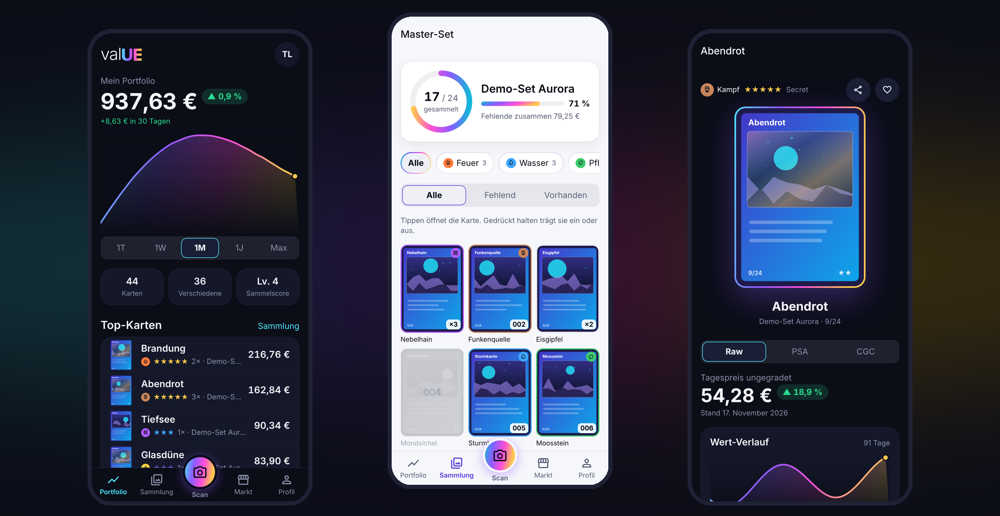

<sub>Aufnahmen der Web-Fassung mit erfundenen Demo-Daten. Kartennamen und Motive sind Platzhalter und zeigen keine echten Karten.</sub>

</div>

---

## Worum es geht

valUE ist eine Sammel-App für Trading Cards mit Fokus auf den europäischen Markt. Sie zeigt, was eine Sammlung zum Tagespreis wert ist, welche Karten in einem Set noch fehlen und was sie zusammen kosten. Sammeln wird zum Spiel: Jede neue Karte bringt XP, seltene Karten mehr, Karten aus der Zeit vor 2000 zählen zusätzlich für den Vintage-Score.

Dieses Repository enthält das Grundgerüst und einen lauffähigen Prototyp: App, eigener Server und Datenabgleich mit [Pokemon Price Tracker](https://www.pokemonpricetracker.com/).

## Funktionen

| | Funktion | Stand |
| --- | --- | --- |
| 📊 | **Portfolio**: Gesamtwert, Veränderung, Wertverlauf mit Holo-Linie (1T bis Max), wertvollste Karten | ✅ Prototyp |
| 📷 | **Scanner**: Karte mit der Kamera erkennen, Nachfrage vor dem Eintragen, Auswahl bei Unsicherheit | ✅ Prototyp |
| 🗂️ | **Master-Sets**: Fortschrittsring, Element-Filter, vorhandene Karten mit Rahmen, fehlende als Silhouette | ✅ Prototyp |
| 💶 | **Restkosten**: was die fehlenden Karten eines Sets zum Tagespreis zusammen kosten | ✅ Prototyp |
| 🃏 | **Kartendetail**: Raw / PSA / CGC, Wert-Verlauf, Grading-Population, Teilen, Beobachten, Bestand je Variante | ✅ Prototyp |
| 🛒 | **Markt**: Suche, größte Gewinner und Verlierer (24 h, 7 und 30 Tage), beobachtete Karten | ✅ Prototyp |
| 🏅 | **Profil**: Level-Ring, Sammelscore, Vintage-Score, 12 Achievements von Bronze bis Holo, Seltenheitsverteilung | ✅ Prototyp |
| 💱 | **Dollar ↔ Euro**: Tipp auf einen Dollarpreis rechnet alle Preise zum EZB-Tageskurs in Euro um, ein weiterer Tipp zeigt wieder Dollar | ✅ Prototyp |
| 🔥 | **Elemente** als Abzeichen und Filter, immer mit Symbol und Name | ✅ Prototyp |
| 🌗 | **Dark und Light Theme** nach dem Design-Moodboard, wählbar (Dunkel, Hell, System), iPhone, iPad, Android, Browser | ✅ Prototyp |
| 🎯 | Scanner mit gelerntem Bildmodell, gemessen an echten Fotos | 🔜 nächste Phase |
| 🇪🇺 | Euro-Preise von Cardmarket | 🔜 geplant |
| 🔐 | Anmeldung mit E-Mail, Apple und Google, Abo und Einmalkauf | 🔜 geplant |

## Screenshots

### Scanner

<table>
  <tr>
    <td align="center" width="25%">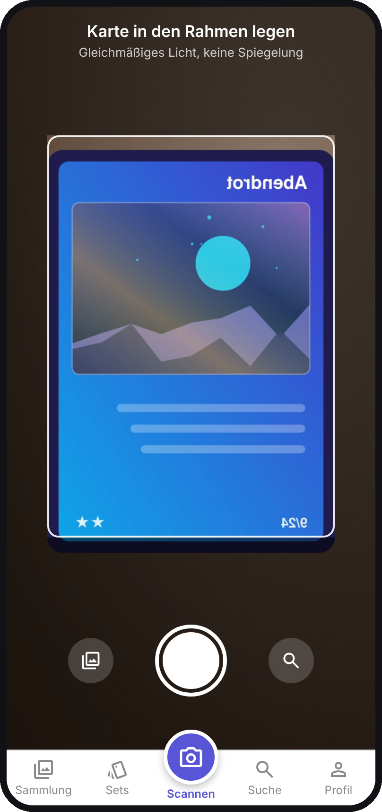<br><sub><b>Karte in den Rahmen</b><br>Kamera-Knopf in der Mitte</sub></td>
    <td align="center" width="25%">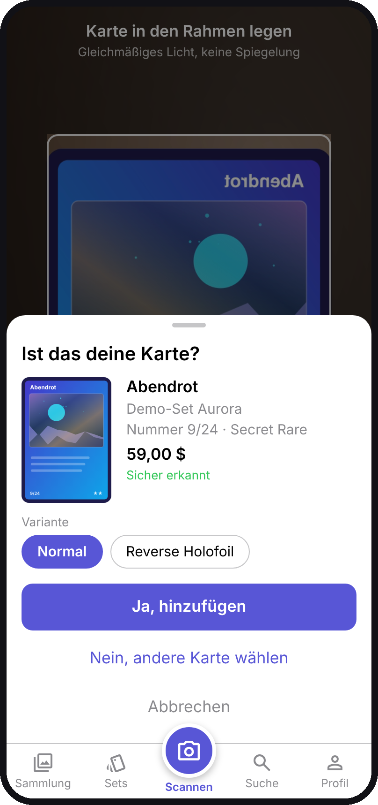<br><sub><b>„Karte erkannt“</b><br>Nachfrage mit Varianten-Auswahl</sub></td>
    <td align="center" width="25%"><br><sub><b>„Welche Karte ist es?“</b><br>Vorschläge bei Unsicherheit</sub></td>
    <td align="center" width="25%">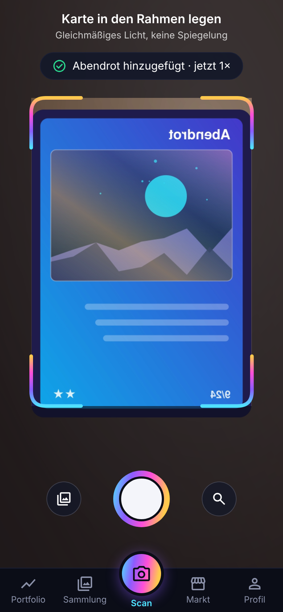<br><sub><b>Hinzugefügt</b><br>bereit für die nächste Karte</sub></td>
  </tr>
</table>

Erkannt wird über Bildvergleich, Kartenname und Kartennummer zusammen. Nichts landet ohne Bestätigung in der Sammlung. Ablauf, Messwerte und Grenzen: [docs/SCANNER.md](docs/SCANNER.md).

### App im Dark Theme

Gestaltet nach dem valUE-Design-Moodboard: Mitternachtsblau, Holo-Verlauf nur für Marke, Haupt-Aktion und Fortschritt, Zahlen zuerst. Mehr dazu in [docs/DESIGN.md](docs/DESIGN.md).

<table>
  <tr>
    <td align="center" width="25%">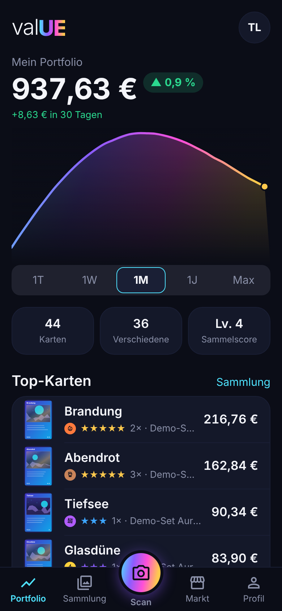<br><sub><b>Portfolio</b><br>Wert, Verlauf, Top-Karten</sub></td>
    <td align="center" width="25%">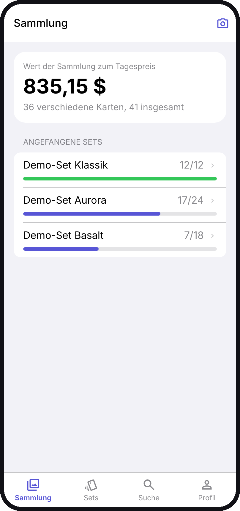<br><sub><b>Sammlung</b><br>Sets mit Fortschrittsring</sub></td>
    <td align="center" width="25%">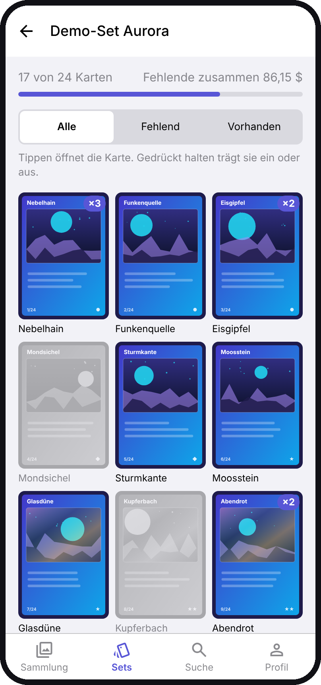<br><sub><b>Master-Set</b><br>Ring, Element-Filter, Silhouetten</sub></td>
    <td align="center" width="25%"><br><sub><b>Kartendetail</b><br>Raw, Wert-Verlauf</sub></td>
  </tr>
  <tr>
    <td align="center">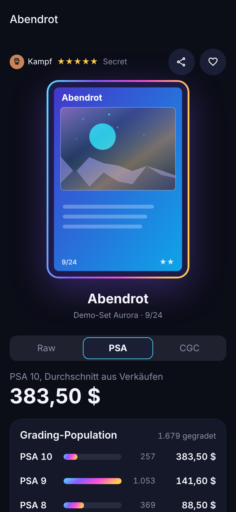<br><sub><b>PSA</b><br>Preis je Note, Population</sub></td>
    <td align="center">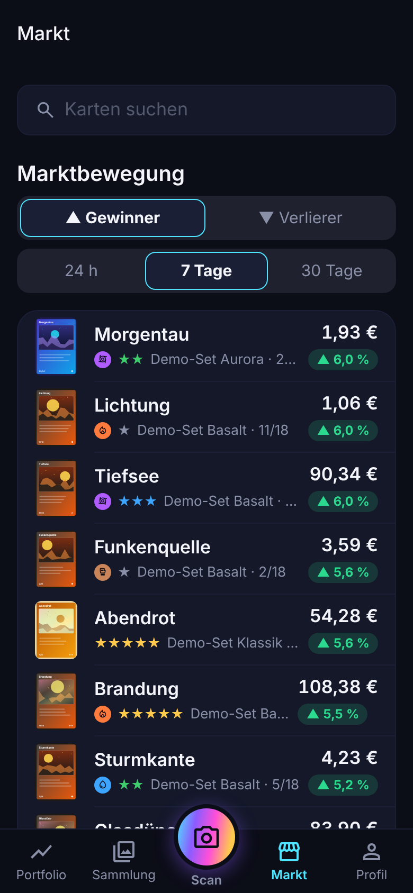<br><sub><b>Markt</b><br>Gewinner, Verlierer, Beobachtet</sub></td>
    <td align="center"><br><sub><b>Profil</b><br>Level-Ring, Scores, Achievements</sub></td>
    <td></td>
  </tr>
</table>

### App im Light Theme

<table>
  <tr>
    <td align="center" width="25%">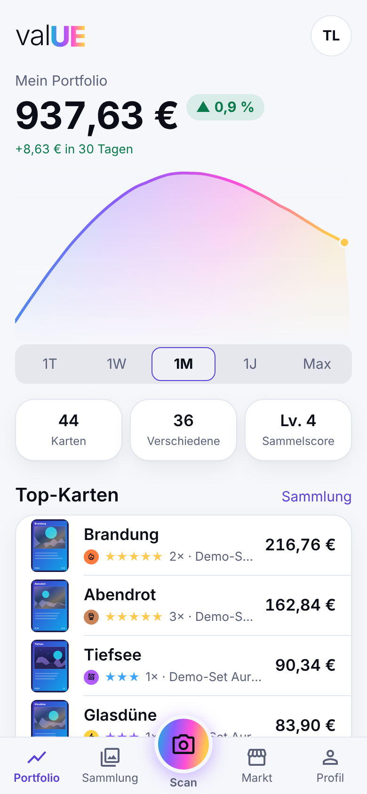</td>
    <td align="center" width="25%">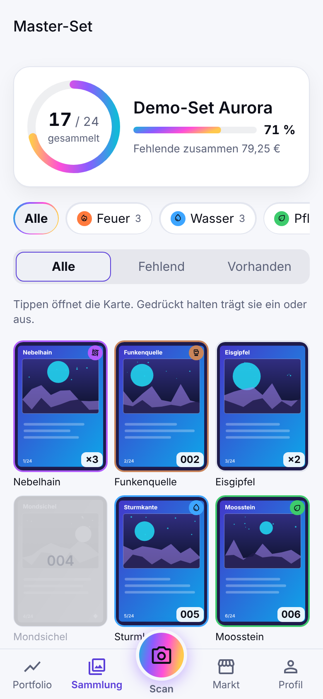</td>
    <td align="center" width="25%">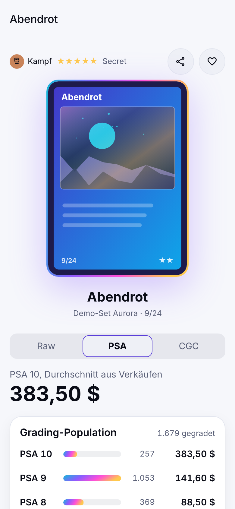</td>
    <td align="center" width="25%">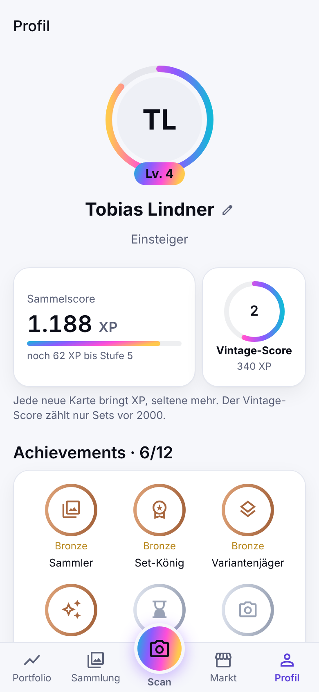</td>
  </tr>
</table>

<details>
<summary><b>Im Browser auf dem Desktop</b></summary>
<br>
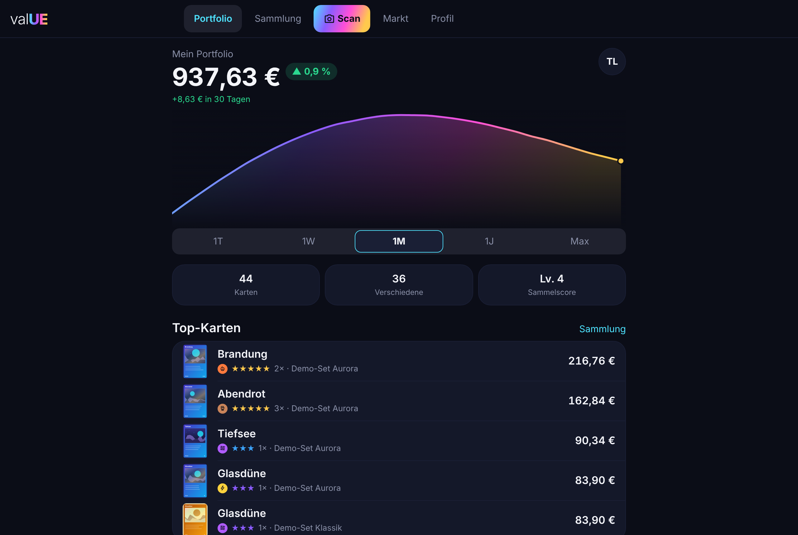
<br><br>
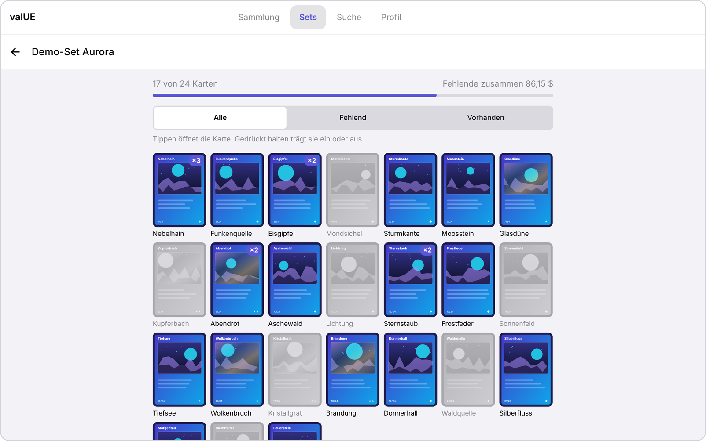
</details>

> [!NOTE]
> Alle Aufnahmen stammen aus der Web-Fassung in Chrome. Auf iOS nutzt die App die Tab-Leiste und Navigationsleisten des Systems mit großen Titeln und sieht deshalb dort anders aus. Auf einem iPhone ist der Prototyp noch nicht gelaufen.

## Architektur

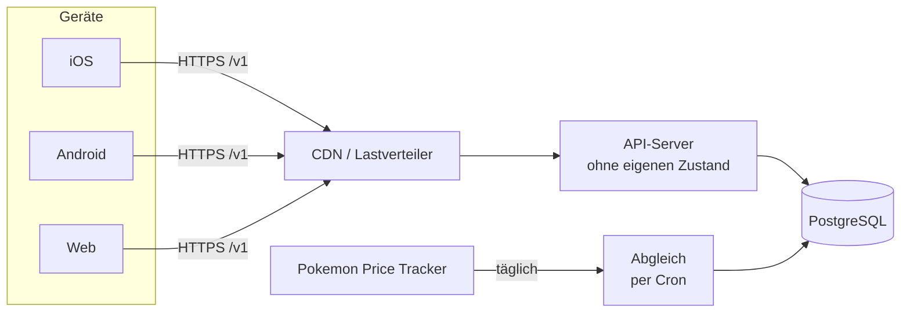

- **Die App spricht nur mit dem eigenen Server.** Der API-Schlüssel des Datenanbieters bleibt auf dem Server.
- **Die Datenkosten wachsen nicht mit der Nutzerzahl.** Der Abgleich holt Katalog und Preise einmal für alle, die API-Server lesen aus der eigenen Datenbank.
- **Katalog-Antworten sind zwischenspeicherbar.** ETag und `Cache-Control` lassen ein CDN die meisten Abrufe selbst beantworten.
- **Mehr Nutzer heißt mehr Server-Instanzen.** Die API hält keinen Zustand; die größte Tabelle ist nach Nutzer aufgeteilt.
- **Der Anbieter ist austauschbar.** Er sitzt hinter einer einzigen Schnittstelle (`PriceSource`).
- **Der Scanner erkennt auf dem Server** und speichert keine Fotos. Die Texterkennung ist der rechenintensivste Teil und deshalb je Prozess und je Absender begrenzt.

Mehr dazu in [docs/ARCHITEKTUR.md](docs/ARCHITEKTUR.md), die Umsetzung der Apple-Richtlinien in [docs/DESIGN.md](docs/DESIGN.md).

## Technik

| Bereich | Werkzeuge |
| --- | --- |
| App | Expo SDK 58, React Native, Expo Router, TanStack Query, `expo-image`, `react-native-svg` (Holo-Verlauf, Diagramme, Ringe), SF Symbols über `expo-symbols` |
| Server | Node.js 22, Fastify 5, PostgreSQL 16 (Partitionierung, Trigramm-Suche), Zod |
| Scanner | `expo-camera`, `expo-image-manipulator`, sharp, Tesseract (tesseract.js) |
| Vertrag | Gemeinsame TypeScript-Typen in `packages/api-types` |
| Qualität | Vitest, GitHub Actions, Lasttest mit autocannon |

## Schnellstart

Voraussetzungen: Node.js 22 oder neuer, Docker.

```bash
npm install
npm run db:up                                  # PostgreSQL starten
cp apps/server/.env.example apps/server/.env
cp apps/mobile/.env.example apps/mobile/.env
npm run db:migrate
npm run seed:demo -w @value/server             # Demo-Daten, kein API-Schlüssel nötig
npm run dev:server                             # Server auf http://localhost:8787
npm run dev:app                                # zweites Terminal
```

Im Expo-Terminal öffnet <kbd>w</kbd> den Browser, <kbd>i</kbd> den iOS-Simulator (Xcode auf einem Mac), <kbd>a</kbd> den Android-Emulator. Auf einem echten Gerät in `apps/mobile/.env` statt `localhost` die IP-Adresse des Rechners im WLAN eintragen.

### Auf dem iPhone testen, ohne Terminal

[`scripts/iPhone-Test.command`](scripts/iPhone-Test.command) im Finder doppelklicken. Das Skript prüft Node.js, Docker und Git, holt den aktuellen Stand, startet Datenbank und Server mit Demo-Daten und zeigt einen QR-Code. Den mit der iPhone-Kamera scannen, dann öffnet sich valUE in „Expo Go“ (kostenlos im App Store). iPhone und Mac müssen im selben WLAN sein. Fenster schließen beendet alles.

### Auf der Synology hosten

Mit Docker und Tailscale, inklusive Skript für den Aufgabenplaner: [deploy/README.md](deploy/README.md).

## Echte Daten laden

> [!IMPORTANT]
> Der API-Schlüssel gehört nur in `apps/server/.env`. Die Datei ist von Git ausgeschlossen. Nie in die App, nie ins Repository.

1. Schlüssel von <https://www.pokemonpricetracker.com/api-keys> in `apps/server/.env` bei `PPT_API_KEY` eintragen.
2. Zuordnung der Felder gegen die echte API prüfen (kostet 2 Credits):
   ```bash
   npm run ppt:probe -w @value/server
   ```
   Sets und Karten sind gegen echte Antworten geprüft (Testvorlagen in `apps/server/test/fixtures`). Das Skript zeigt die echten Feldnamen und meldet, was der Server nicht findet, etwa bei gegradeten Preisen, die der Free-Tarif nicht liefert.
3. Abgleich starten:
   ```bash
   npm run sync
   ```

Der kostenlose Tarif hat 100 Credits am Tag, ein Set kostet einen Credit je Karte. Voreingestellt ist deshalb ein kleines Set mit höchstens 90 Credits je Lauf; größere Sets überspringt der Abgleich mit Hinweis. Sobald die App Einnahmen hat, verlangt die Lizenz des Anbieters den Business-Tarif. Dann `SYNC_MODE=export` setzen: Der Server lädt den ganzen Katalog täglich als Datei, ohne Credits.

## Qualität

```bash
npm run typecheck      # Server, App und Vertrag
npm test               # 52 Servertests gegen PostgreSQL, darunter Scanner mit simulierten Fotos
```

Lasttest mit **50.000 Karten, 10.000 Nutzern und 3 Mio. Sammlungseinträgen** auf einer Maschine mit 2 Kernen, ohne Fehler:

| Abruf | Anfragen pro Sekunde | Median |
| --- | ---: | ---: |
| Set mit 250 Karten | 1.293 | 34 ms |
| Set, App hat den Stand schon (304) | 22.471 | 2 ms |
| Kartendetail mit Verlauf | 1.885 | 25 ms |
| Karte eintragen | 3.915 | 11 ms |
| Profil mit Score und Achievements | 202 | 231 ms |
| Portfolio mit Wertverlauf (30 Tage, je 300 Karten) | 61 | 775 ms |
| Markt: Gewinner und Verlierer | 12.270 | 3 ms |
| Beobachtete Karten | 2.857 | 16 ms |

Alle Messwerte, Bedingungen und das Vorgehen zum Nachmessen stehen in [docs/ARCHITEKTUR.md](docs/ARCHITEKTUR.md#lasttest).

## Projektstruktur

```
apps/
  mobile/            App für iOS, Android und Web (Expo)
    src/app/         Bildschirme (dateibasiertes Routing)
    src/api/         Anbindung an den eigenen Server
    src/scan/        Suchrahmen, Fotoaufbereitung, Ergebnisblatt
    src/components/  Bausteine: Holo-Verlauf, Diagramme, Kartenkachel, Abzeichen, Listen
    src/theme/       Dark und Light Theme aus dem Moodboard, Schrift, Abstände, Darstellung
  server/            API-Server und Abgleich
    migrations/      Datenbankschema
    src/sources/     Anbindung an Pokemon Price Tracker
    src/sync/        Abgleich (Einzelabrufe oder Tages-Export)
    src/scan/        Scanner: Fingerabdruck, Texterkennung, Bewertung
    src/http/        Endpunkte /v1
packages/
  api-types/         Vertrag zwischen App und Server
docs/                Architektur, Gestaltung, Screenshots
graphify/            Wissensgraph des Repositorys zur Orientierung (siehe graphify/README.md)
```

## Fahrplan

- [x] Grundgerüst: App, Server, Datenbank, Abgleich, Tests, CI
- [x] Master-Set-Ansicht, Kartendetail, Suche, Profil mit Scores
- [x] Scanner mit Nachfrage und Auswahl bei Unsicherheit
- [x] Design nach Moodboard: Dark und Light Theme, Portfolio, Markt, Achievements, Elemente, Grading
- [ ] Erster Lauf im iOS-Simulator und auf Android
- [x] Zuordnung gegen die echte API geprüft: Sets, Karten, Varianten, Element, Preisverlauf
- [ ] Erster vollständiger Abgleich; gegradete Preise und Population mit Business-Tarif prüfen
- [ ] Scanner an echten Fotos messen, gelerntes Bildmodell
- [ ] Anmeldung, Abo und Einmalkauf
- [ ] Euro-Preise von Cardmarket; Graded-Preise und Population mit echtem Tarif prüfen
- [ ] Portfolio-Verlauf als tägliche Momentaufnahme je Nutzer, damit er bei großen Sammlungen schnell bleibt

## Rechtliches

valUE ist ein unabhängiges Projekt und steht in keiner Verbindung zu Nintendo, The Pokémon Company, Creatures, Game Freak oder Pokemon Price Tracker. Die Demo-Daten und -Motive sind erfunden. Kartenbilder und Kartendaten der Datenquelle sind nicht Teil dieses Repositorys.

Für dieses Repository ist noch keine Lizenz festgelegt. Ohne Lizenz bleiben alle Rechte beim Urheber.
