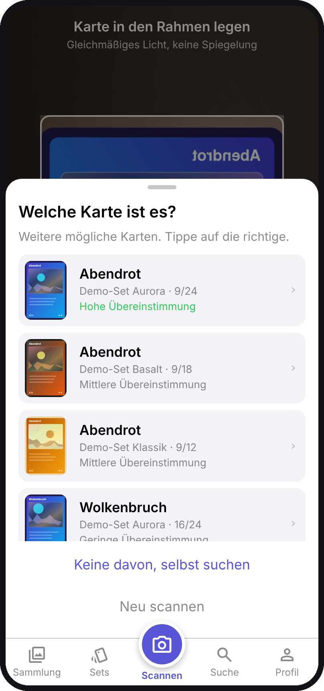
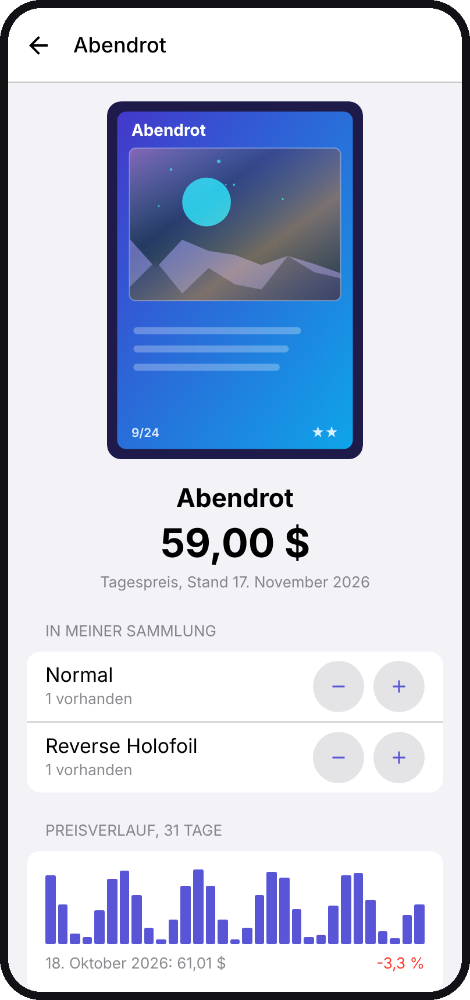
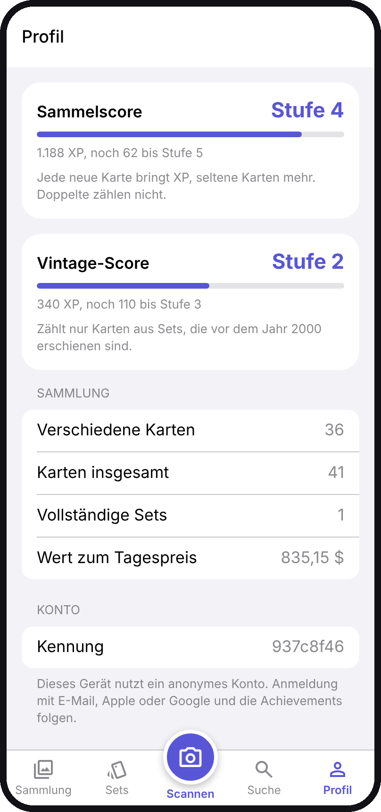
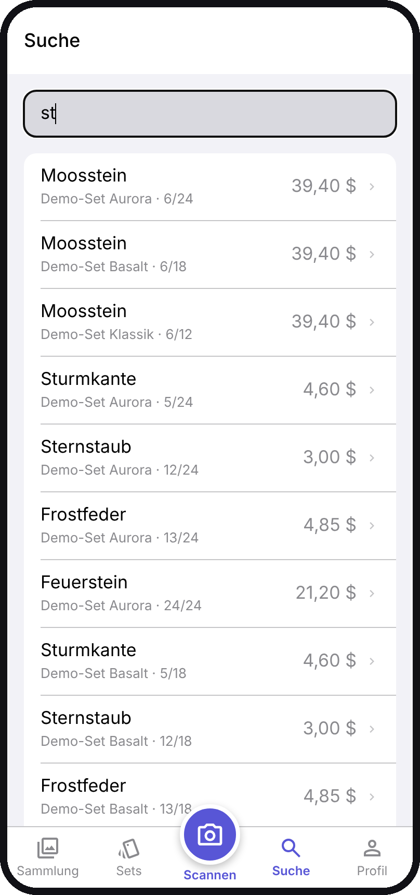
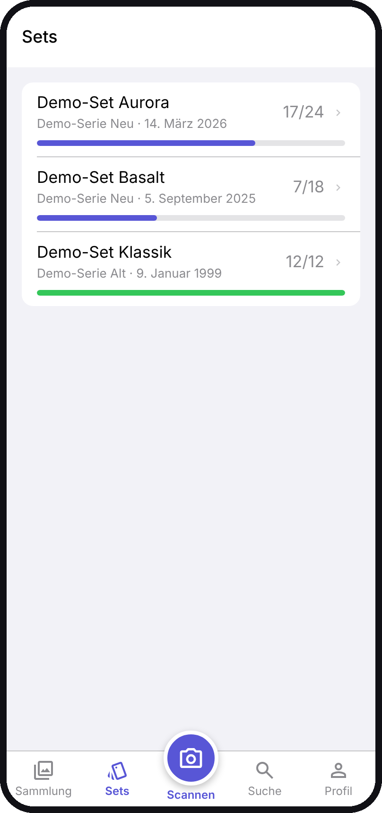
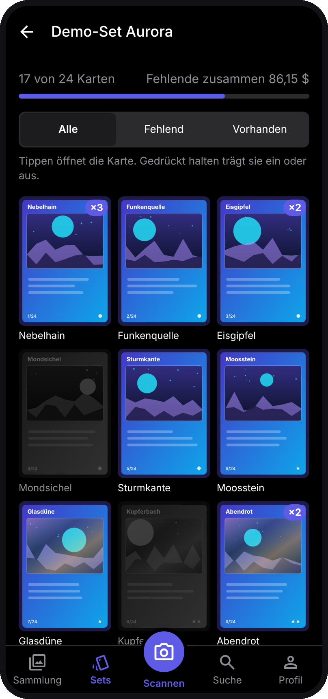
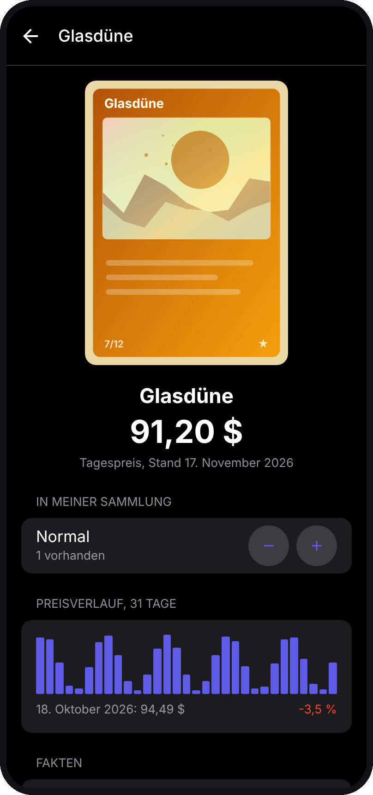
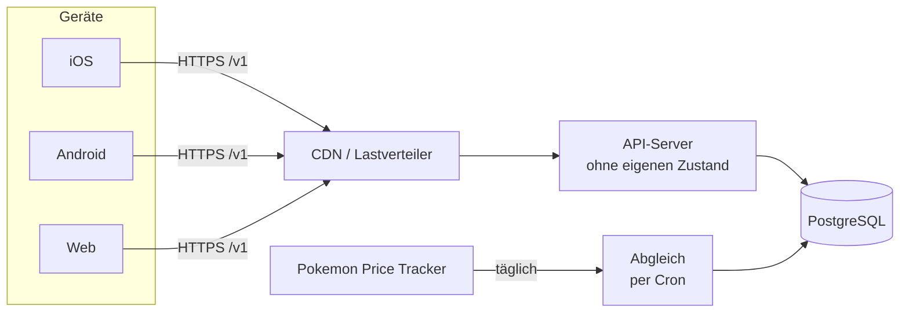

<div align="center">

# valUE

**Deine Sammelkarten. Ihr Wert. Jedes Set im Blick.**

Karten scannen, Master-Sets vervollständigen, Tagespreise verfolgen. Für iOS, Android und das Web aus einem Code.

[](https://github.com/Intracy/valUE/actions/workflows/ci.yml)


<sub>Aufnahmen der Web-Fassung mit erfundenen Demo-Daten. Kartennamen und Motive sind Platzhalter und zeigen keine echten Karten.</sub>

</div>

---

## Worum es geht

valUE ist eine Sammel-App für Trading Cards mit Fokus auf den europäischen Markt. Sie zeigt, was eine Sammlung zum Tagespreis wert ist, welche Karten in einem Set noch fehlen und was sie zusammen kosten. Sammeln wird zum Spiel: Jede neue Karte bringt XP, seltene Karten mehr, Karten aus der Zeit vor 2000 zählen zusätzlich für den Vintage-Score.

Dieses Repository enthält das Grundgerüst und einen lauffähigen Prototyp: App, eigener Server und Datenabgleich mit [Pokemon Price Tracker](https://www.pokemonpricetracker.com/).

## Funktionen

| | Funktion | Stand |
| --- | --- | --- |
| 📷 | **Scanner**: Karte mit der Kamera erkennen, Nachfrage vor dem Eintragen, Auswahl bei Unsicherheit | ✅ Prototyp |
| 🗂️ | **Master-Sets**: alle Karten eines Sets im Raster, vorhandene farbig, fehlende ausgegraut, Filter „Fehlend“ und „Vorhanden“ | ✅ Prototyp |
| 💶 | **Restkosten**: was die fehlenden Karten eines Sets zum Tagespreis zusammen kosten | ✅ Prototyp |
| 🃏 | **Kartendetail** mit Tagespreis, Preisverlauf, Varianten und Fakten | ✅ Prototyp |
| 📈 | **Sammlungswert** zum Tagespreis, Fortschritt je Set | ✅ Prototyp |
| 🏅 | **Sammelscore und Vintage-Score** mit Stufen | ✅ Prototyp |
| 🔎 | **Suche** nach Kartennamen über alle Sets | ✅ Prototyp |
| 🌗 | Hell und Dunkel, iPhone, iPad, Android und Browser | ✅ Prototyp |
| 🎯 | Scanner mit gelerntem Bildmodell, gemessen an echten Fotos | 🔜 nächste Phase |
| 🏆 | Achievements und Profil-Schmuck | 🔜 geplant |
| 🇪🇺 | Euro-Preise von Cardmarket, Graded-Preise, Population | 🔜 geplant |
| 🔐 | Anmeldung mit E-Mail, Apple und Google, Abo und Einmalkauf | 🔜 geplant |

## Screenshots

### Scanner

<table>
  <tr>
    <td align="center" width="25%"><br><sub><b>Karte in den Rahmen</b><br>Kamera-Knopf in der Mitte</sub></td>
    <td align="center" width="25%"><br><sub><b>„Ist das deine Karte?“</b><br>mit Varianten-Auswahl</sub></td>
    <td align="center" width="25%"><br><sub><b>„Welche Karte ist es?“</b><br>Vorschläge bei Unsicherheit</sub></td>
    <td align="center" width="25%"><br><sub><b>Hinzugefügt</b><br>bereit für die nächste Karte</sub></td>
  </tr>
</table>

Erkannt wird über Bildvergleich, Kartenname und Kartennummer zusammen. Nichts landet ohne Bestätigung in der Sammlung. Ablauf, Messwerte und Grenzen: [docs/SCANNER.md](docs/SCANNER.md).

### App

<table>
  <tr>
    <td align="center" width="33%"><br><sub><b>Sammlung</b><br>Wert und angefangene Sets</sub></td>
    <td align="center" width="33%"><br><sub><b>Master-Set</b><br>fehlende Karten ausgegraut</sub></td>
    <td align="center" width="33%"><br><sub><b>Kartendetail</b><br>Preis, Verlauf, Bestand</sub></td>
  </tr>
  <tr>
    <td align="center"><br><sub><b>Profil</b><br>Sammelscore und Vintage-Score</sub></td>
    <td align="center"><br><sub><b>Suche</b><br>über alle Sets</sub></td>
    <td align="center"><br><sub><b>Sets</b><br>Fortschritt je Set</sub></td>
  </tr>
  <tr>
    <td align="center"><br><sub><b>Dunkelmodus</b></sub></td>
    <td align="center"><br><sub><b>Vintage-Set im Dunkelmodus</b></sub></td>
    <td></td>
  </tr>
</table>

<details>
<summary><b>Im Browser auf dem Desktop</b></summary>
<br>

</details>

> [!NOTE]
> Alle Aufnahmen stammen aus der Web-Fassung in Chrome. Auf iOS nutzt die App die Tab-Leiste und Navigationsleisten des Systems mit großen Titeln und sieht deshalb dort anders aus. Auf einem iPhone ist der Prototyp noch nicht gelaufen.

## Architektur



- **Die App spricht nur mit dem eigenen Server.** Der API-Schlüssel des Datenanbieters bleibt auf dem Server.
- **Die Datenkosten wachsen nicht mit der Nutzerzahl.** Der Abgleich holt Katalog und Preise einmal für alle, die API-Server lesen aus der eigenen Datenbank.
- **Katalog-Antworten sind zwischenspeicherbar.** ETag und `Cache-Control` lassen ein CDN die meisten Abrufe selbst beantworten.
- **Mehr Nutzer heißt mehr Server-Instanzen.** Die API hält keinen Zustand; die größte Tabelle ist nach Nutzer aufgeteilt.
- **Der Anbieter ist austauschbar.** Er sitzt hinter einer einzigen Schnittstelle (`PriceSource`).
- **Der Scanner erkennt auf dem Server** und speichert keine Fotos. Die Texterkennung ist der rechenintensivste Teil und deshalb je Prozess und je Absender begrenzt.

Mehr dazu in [docs/ARCHITEKTUR.md](docs/ARCHITEKTUR.md), die Umsetzung der Apple-Richtlinien in [docs/DESIGN.md](docs/DESIGN.md).

## Technik

| Bereich | Werkzeuge |
| --- | --- |
| App | Expo SDK 58, React Native, Expo Router, TanStack Query, `expo-image`, SF Symbols über `expo-symbols` |
| Server | Node.js 22, Fastify 5, PostgreSQL 16 (Partitionierung, Trigramm-Suche), Zod |
| Scanner | `expo-camera`, `expo-image-manipulator`, sharp, Tesseract (tesseract.js) |
| Vertrag | Gemeinsame TypeScript-Typen in `packages/api-types` |
| Qualität | Vitest, GitHub Actions, Lasttest mit autocannon |

## Schnellstart

Voraussetzungen: Node.js 22 oder neuer, Docker.

```bash
npm install
npm run db:up                                  # PostgreSQL starten
cp apps/server/.env.example apps/server/.env
cp apps/mobile/.env.example apps/mobile/.env
npm run db:migrate
npm run seed:demo -w @value/server             # Demo-Daten, kein API-Schlüssel nötig
npm run dev:server                             # Server auf http://localhost:8787
npm run dev:app                                # zweites Terminal
```

Im Expo-Terminal öffnet <kbd>w</kbd> den Browser, <kbd>i</kbd> den iOS-Simulator (Xcode auf einem Mac), <kbd>a</kbd> den Android-Emulator. Auf einem echten Gerät in `apps/mobile/.env` statt `localhost` die IP-Adresse des Rechners im WLAN eintragen.

## Echte Daten laden

> [!IMPORTANT]
> Der API-Schlüssel gehört nur in `apps/server/.env`. Die Datei ist von Git ausgeschlossen. Nie in die App, nie ins Repository.

1. Schlüssel von <https://www.pokemonpricetracker.com/api-keys> in `apps/server/.env` bei `PPT_API_KEY` eintragen.
2. Zuordnung der Felder gegen die echte API prüfen (kostet 2 Credits):
   ```bash
   npm run ppt:probe -w @value/server
   ```
   Die API-Referenz beschreibt die Antworten von `/sets` und `/cards` nur teilweise. Das Skript zeigt die echten Feldnamen und meldet, was der Server nicht findet.
3. Abgleich starten:
   ```bash
   npm run sync
   ```

Der kostenlose Tarif hat 100 Credits am Tag, ein Set kostet einen Credit je Karte. Voreingestellt ist deshalb ein kleines Set mit höchstens 90 Credits je Lauf; größere Sets überspringt der Abgleich mit Hinweis. Sobald die App Einnahmen hat, verlangt die Lizenz des Anbieters den Business-Tarif. Dann `SYNC_MODE=export` setzen: Der Server lädt den ganzen Katalog täglich als Datei, ohne Credits.

## Qualität

```bash
npm run typecheck      # Server, App und Vertrag
npm test               # 39 Servertests gegen PostgreSQL, darunter Scanner mit simulierten Fotos
```

Lasttest mit **50.000 Karten, 10.000 Nutzern und 3 Mio. Sammlungseinträgen** auf einer Maschine mit 2 Kernen, ohne Fehler:

| Abruf | Anfragen pro Sekunde | Median |
| --- | ---: | ---: |
| Set mit 250 Karten | 1.293 | 34 ms |
| Set, App hat den Stand schon (304) | 22.471 | 2 ms |
| Kartendetail mit Verlauf | 1.885 | 25 ms |
| Karte eintragen | 3.915 | 11 ms |
| Profil mit Score | 295 | 172 ms |

Alle Messwerte, Bedingungen und das Vorgehen zum Nachmessen stehen in [docs/ARCHITEKTUR.md](docs/ARCHITEKTUR.md#lasttest).

## Projektstruktur

```
apps/
  mobile/            App für iOS, Android und Web (Expo)
    src/app/         Bildschirme (dateibasiertes Routing)
    src/api/         Anbindung an den eigenen Server
    src/scan/        Suchrahmen, Fotoaufbereitung, Ergebnisblatt
    src/components/  Bausteine: Kartenkachel, Listen, Zustände
    src/theme/       Farben, Schrift und Abstände nach den Apple-Richtlinien
  server/            API-Server und Abgleich
    migrations/      Datenbankschema
    src/sources/     Anbindung an Pokemon Price Tracker
    src/sync/        Abgleich (Einzelabrufe oder Tages-Export)
    src/scan/        Scanner: Fingerabdruck, Texterkennung, Bewertung
    src/http/        Endpunkte /v1
packages/
  api-types/         Vertrag zwischen App und Server
docs/                Architektur, Gestaltung, Screenshots
```

## Fahrplan

- [x] Grundgerüst: App, Server, Datenbank, Abgleich, Tests, CI
- [x] Master-Set-Ansicht, Kartendetail, Suche, Profil mit Scores
- [x] Scanner mit Nachfrage und Auswahl bei Unsicherheit
- [ ] Erster Lauf im iOS-Simulator und auf Android
- [ ] Zuordnung gegen die echte API prüfen, erster echter Abgleich
- [ ] Scanner an echten Fotos messen, gelerntes Bildmodell
- [ ] Achievements und Profil-Schmuck
- [ ] Anmeldung, Abo und Einmalkauf
- [ ] Euro-Preise, Graded-Preise und Population

## Rechtliches

valUE ist ein unabhängiges Projekt und steht in keiner Verbindung zu Nintendo, The Pokémon Company, Creatures, Game Freak oder Pokemon Price Tracker. Die Demo-Daten und -Motive sind erfunden. Kartenbilder und Kartendaten der Datenquelle sind nicht Teil dieses Repositorys.

Für dieses Repository ist noch keine Lizenz festgelegt. Ohne Lizenz bleiben alle Rechte beim Urheber.
